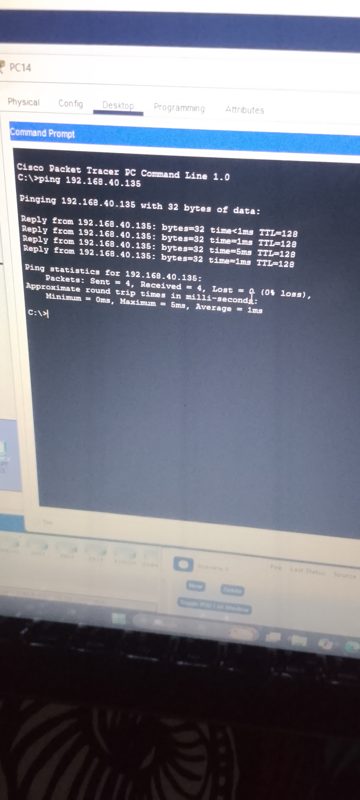

# Multi-Switch Inter-VLAN Routing Project

This project demonstrates a multi-switch enterprise topology built in Cisco Packet Tracer. It features Layer 2 VLAN segregation across an access switch, an optimized 802.1Q trunk link with a secure native VLAN, and Layer 3 Inter-VLAN routing executed via a Multilayer Switch (Switch 2).

##  Topology Overview

- **Switch 1 (Access Switch):** Hosts end-user devices for VLAN 10, VLAN 20, and VLAN 30.
- **Trunk Link:** Connects Switch 1 to Switch 2. It restricts traffic to authorized VLANs and isolates untagged frames using a custom Native VLAN.
- **Switch 2 (Multilayer Switch):** Hosts local devices for VLAN 10 and VLAN 40. It acts as the default gateway for all subnets, providing full Layer 3 Inter-VLAN line-rate routing.

---

##  Subnetting Architecture

The core network space **192.168.40.0/24** was partitioned into 4 equal segments to maximize efficiency and minimize IP wasting. By borrowing 2 bits, the network uses a **`/26` prefix (Subnet Mask: 255.255.255.192)**, yielding 62 usable host addresses per subnet.

| VLAN ID | Department / Function | Network Address | Usable Host IP Range | Gateway Address (SVI) | Subnet Mask |
| :--- | :--- | :--- | :--- | :--- | :--- |
| **VLAN 10** | Data / Devices 1 | `192.168.40.0` | `192.168.40.2` - `192.168.40.62` | `192.168.40.62` | `255.255.255.192` |
| **VLAN 20** | Data / Devices 2 | `192.168.40.64` | `192.168.40.65` - `192.168.40.126` | `192.168.40.126` | `255.255.255.192` |
| **VLAN 30** | Data / Devices 3 | `192.168.40.128` | `192.168.40.129` - `192.168.40.190` | `192.168.40.190` | `255.255.255.192` |
| **VLAN 40** | Data / Devices 4 | `192.168.40.192` | `192.168.40.193` - `192.168.40.254` | `192.168.40.254` | `255.255.255.192` |
| **VLAN 999**| Secure Native VLAN | *N/A* | *Unassigned* | *N/A* | *N/A* |

---

## ⚙️ Core Configuration Highlights

### 1. Trunk Port Optimization (Switch 1 & Switch 2)
To secure the transit path between switches, the default Native VLAN 1 was modified to VLAN 999, and strict VLAN pruning was enforced:
```text
interface GigabitEthernet0/1
 switchport trunk encapsulation dot1q
 switchport mode trunk
 switchport trunk native vlan 999
 switchport trunk allowed vlan 10,20,30,40,999
```

### 2. Enabling Inter-VLAN Routing (Switch 2)
The hardware routing engine was enabled on the multilayer switch alongside Switch Virtual Interfaces (SVIs) to serve as local default gateways:
```text
ip routing

interface Vlan10
 ip address 192.168.40.62 255.255.255.192

!
interface Vlan20
 ip address 192.168.40.126 255.255.255.192
!
interface Vlan30
 ip address 192.168.40.190 255.255.255.192
!
interface Vlan40
 ip address 192.168.40.254 255.255.255.192
```

## 🔍 Verification & Testing
- **Intra-VLAN Verification:** Host-to-host connectivity within individual VLANs communicates successfully at Layer 2 via MAC forwarding tables.
- **Inter-VLAN Routing Verification:** ICMP traffic successfully navigates across boundaries (e.g., VLAN 10 to VLAN 40) via Switch 2's routing table (`show ip route`).

